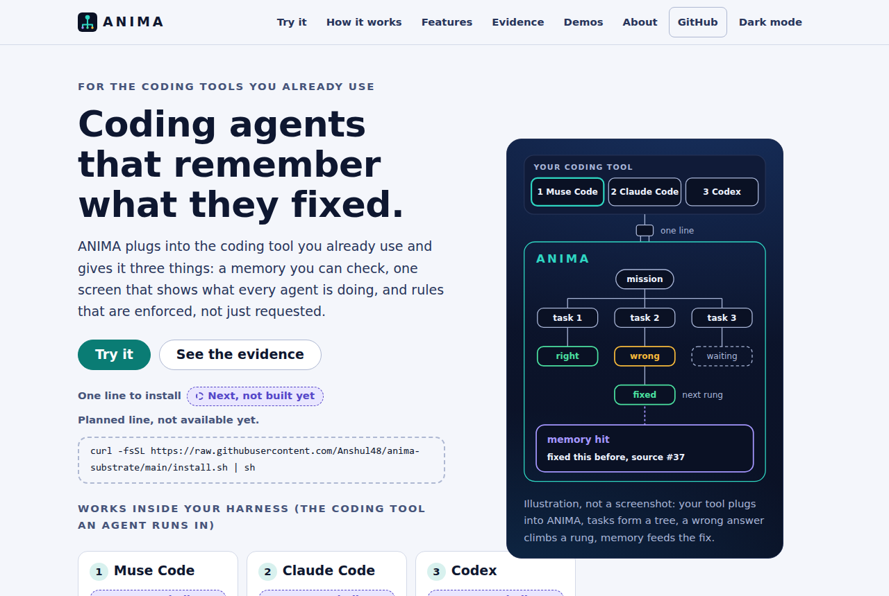

<p align="center">
  
</p>
<p align="center"><sub>The project site's front page, as rendered. The diagram on the right is an illustration of the design, not a screenshot of the product.</sub></p>

# ANIMA

**Coding agents that remember what they fixed.**

ANIMA plugs into the coding tool you already use, **Muse Code first, then Claude Code, then Codex**, and gives it three things: a memory you can check ([TRACE](https://github.com/Anshul48/trace)), one screen that shows what every agent is doing, and rules that are enforced, not just requested.

**Muse Code first.** Muse Code is the first harness ANIMA is built for, and in both recorded runs (nine jobs each) the first rung of its ladder was a Muse Code worker. It was also our main headless worker tool while we built this project: 670 recorded jobs on two machines, 619 finished, about 170 hours of summed worker time, from 1 to 4 November 2026. These are counts from our own job records. We make no claim about cost or speed differences between Muse Code, Claude Code and Codex.

**Site:** [anshul48.github.io/anima-substrate](https://anshul48.github.io/anima-substrate/) &nbsp;|&nbsp; **Status of every part:** [docs/status.json](docs/status.json) &nbsp;|&nbsp; **Docs index:** [docs/INDEX.md](docs/INDEX.md)

## What is built and what is not

Every claim in this README comes from one file, [`docs/status.json`](docs/status.json). A part may say **Working today** only if it lists a command anyone can run and a file that backs it. The table below is generated from that file, and a check in CI fails if it disagrees.

<!-- block:status:start (generated from docs/status.json by tools/site.py sync-readme) -->

| Part | State | What exists today |
|---|---|---|
| [Memory (TRACE)](https://anshul48.github.io/anima-substrate/memory.html) | **Prototype** | TRACE, our public search that shows its work, is the memory. One small recorded test exists: a helper asked TRACE 20 questions over our full test library, and a hidden checker with 23 rules accepted the recorded answers. The command that stores a fix in one session and brings it back in a new one does not exist yet. |
| [Your harness](https://anshul48.github.io/anima-substrate/harnesses.html) | **Next, not built yet** | Nothing is wired yet. The three tools have command-line modes, and ANIMA's adapters are meant to call them. |
| [One-line install](https://anshul48.github.io/anima-substrate/install.html) | **Next, not built yet** | Nothing to install yet. Today you clone the repository and run the record check (see Try it). |
| [One screen (SST)](https://anshul48.github.io/anima-substrate/state-tree.html) | **Next, not built yet** | The recorded nine-job run exists as a decision log with 69 records, which is what the screen reads. The screen itself is not built yet. |
| [Voice](https://anshul48.github.io/anima-substrate/voice.html) | **Next, not built yet** | Nothing is built yet. The plan uses faster-whisper, a local speech-to-text library, running on the CPU. |
| [Roles and rules](https://anshul48.github.io/anima-substrate/rules.html) | **Prototype** | Three of five parts exist in some form: the hidden checker and the ladder (one job type, recorded run) and the tamper-evident record (anyone can check it). Roles and the rules pack are designed, not built. |

Roles and rules, part by part: Roles: Next, not built yet, Enforced rules: Next, not built yet, Hidden checker: Prototype, Escalation ladder: Prototype, Tamper-evident record: Working today.

Rendered from [`docs/status.json`](docs/status.json); `python3 tools/site.py check` fails if this table or the site disagrees with it.

<!-- block:status:end -->

Marks on the site are never colour alone: filled dot = working today, half dot = prototype, dashed dot = next, not built yet.

## 1. Works inside your harness: Muse Code first

A harness is the coding tool an agent runs in. ANIMA does not replace it; it plugs in. Muse Code first, then Claude Code, then Codex.

<!-- block:harness:start (generated from docs/status.json by tools/site.py sync-readme) -->

| # | Harness | State | Command |
|---|---|---|---|
| 1 | Muse Code | **Next, not built yet** | planned, not available yet: `anima run --harness muse --task examples/tiny-bug` |
| 2 | Claude Code | **Next, not built yet** | planned, not available yet: `anima run --harness claude --task examples/tiny-bug` |
| 3 | Codex | **Next, not built yet** | planned, not available yet: `anima run --harness codex --task examples/tiny-bug` |

<!-- block:harness:end -->

## 2. Memory that carries over: TRACE

In a coding workflow the same bug gets fixed twice and the same decision gets explained again. ANIMA's memory is **TRACE**, our public search that shows its work: every answer comes with a record of where it came from. Everything in this section is **our own measurement**; no outside party has verified it. It is TRACE's record, not an ANIMA result.

<!-- block:memory-state:start (generated from docs/status.json by tools/site.py sync-readme) -->

**Prototype.** TRACE, our public search that shows its work, is the memory. One small recorded test exists: a helper asked TRACE 20 questions over our full test library, and a hidden checker with 23 rules accepted the recorded answers. The command that stores a fix in one session and brings it back in a new one does not exist yet.

Planned: `anima memory put "decision: retries stay at three"` stores a decision or a fix. In a new session, `anima memory ask "how many retries?"` brings it back with the text and a record id that points to where it came from.

Limit: A small local store, not the 100-million-token library. It aims at continuity (the agent knows what was decided before) and makes no claim of better fixes. The 20-question test is a small sample.

<!-- block:memory-state:end -->

**The sealed library we tested on: 812,545 passages, 99,891,846 tokens.** The planned 100-million-token gate was waived: the library falls short by 108,154 tokens (0.11%).

- **Sparse activation.** A question wakes only the few groups likely to hold the answer. On 50 test searches (40 written questions and 10 taken from passage openings) TRACE scored **0.79% of the rows**, measured on one of the library's four equal parts. That is about **127 times less scoring work** than looking at everything, and it kept **0.9985 of exact meaning-based search's results**.
- **Groups that hold answers together.** The library is sorted into small groups of about nine passages. A search's ten best matches fell into about 7 groups on average, out of at most 10; random groups would give 10. The groups come from one ordinary sorting run, so we do not claim the library organises itself as it grows.
- **A checkable record on every answer.** Each result carries a record of where it came from, with a fingerprint you can recompute yourself.

**Earlier, larger tests (ours, kept apart from the numbers above):**

- **504,480,146 tokens.** Around 28 October 2026 we sealed a TRACE memory of 504,480,146 tokens in 13 parts on a cloud machine. That machine has since been shut down, so this test cannot be re-run. It is an earlier test by us, recorded in our own receipts, and nobody outside has checked it.
- **1.53 billion tokens, routing only.** A separate test on rented GPUs (16 October 2026) turned 1,531,809,092 tokens of a different, larger collection into 7,134,906 searchable vectors in 109 pieces. A search that looked only at the most likely groups kept 0.9947 of the exact top ten while looking at 6.6% of the vectors. It tested routing only: no merged index, not served through TRACE, no checkable records at that scale, and not a one-billion-vector run.

**Where TRACE does not win:** on the same 50 test searches, ordinary keyword search put the right source passage in its top ten for 82% of searches; TRACE did for 52%, and so did exact meaning-based search. Keyword search also had the shorter response time (6 milliseconds against 1.2 seconds for TRACE). Stored size on disk: TRACE 2.28 GB, exact vectors 1.25 GB, keyword index 0.51 GB. TRACE has not been run on public benchmarks, and there is no public query service. Details: [the memory page](https://anshul48.github.io/anima-substrate/memory.html) and the [TRACE repository](https://github.com/Anshul48/trace).

## 3. One line to install

<!-- block:install:start (generated from docs/status.json by tools/site.py sync-readme) -->

**One-line install: Next, not built yet.** Planned line (not available yet; the address only works after the project's first push to GitHub):

```text
curl -fsSL https://raw.githubusercontent.com/Anshul48/anima-substrate/main/install.sh | sh
```

<!-- block:install:end -->

Today the way in is a clone. You need Python 3 and git; the download is about 11 MB.

```bash
git clone https://github.com/Anshul48/anima-substrate
cd anima-substrate
python3 docs/evidence/flagship-run3/check_chain.py --tamper
```

## 4. One screen: the State Space Tree (SST)

<!-- block:sst:start (generated from docs/status.json by tools/site.py sync-readme) -->

**Next, not built yet.** Every agent, task and attempt on one screen, drawn as a tree you can follow. SST stands for State Space Tree. [What it will look like and what exists](https://anshul48.github.io/anima-substrate/state-tree.html).

<!-- block:sst:end -->

## 5. Talk to it

<!-- block:voice-state:start (generated from docs/status.json by tools/site.py sync-readme) -->

**Next, not built yet.** Nothing is built yet. The plan uses faster-whisper, a local speech-to-text library, running on the CPU.

Planned: `anima voice --file voice/samples/status.wav` prints what it heard and the command it understood, for example {"cmd":"status"}. Starting or stopping a task needs a typed confirmation.

Limit: About six fixed English commands. Shown first from a recorded clip, because a microphone can fail inside WSL. The delay has not been measured.

<!-- block:voice-state:end -->

## 6. Roles and enforced rules

Architect, manager and worker; secrets, no-push and budgets; a hidden checker; a tamper-evident record. This is the professional discipline behind the other five parts: written down once, and enforced by a program, not by an agent's good intentions. [Design: docs/ROLES-AND-RULES.md](docs/ROLES-AND-RULES.md).

<!-- block:rules-state:start (generated from docs/status.json by tools/site.py sync-readme) -->

**Prototype.** Three of five parts exist in some form: the hidden checker and the ladder (one job type, recorded run) and the tamper-evident record (anyone can check it). Roles and the rules pack are designed, not built.

Planned: One file, `anima.yaml`, holds roles, permissions, budgets, watches and the ladder, so it works on any harness.

Limit: Designed from how we actually run our own work. ANIMA has two of ten of those controls today.

<!-- block:rules-state:end -->

## What is real today, for one kind of job

We gave the hidden checker and the ladder nine real bug-fixing jobs from well-known open-source Python libraries, and wrote every decision down. The ladder is the order of helpers: a Muse Code worker first (in the recorded runs), then Claude Sonnet, then Codex. Each wrong answer moves up to a stronger helper.

- **Nine jobs.** Each one is a real bug with a plain-English description. The agent has to fix it.
- **Seven were right the first time.** A Muse Code worker did the work, and the hidden tests agreed.
- **Two were wrong.** The agent said "done" both times. The checker said no, the next helper (Claude Sonnet) fixed both, and all nine ended verified.

A trimmed copy of the real log ([full file](docs/evidence/flagship-run3/real3.log)):

```text
REAL cachetools-unbound-keyword rung=0 pool=laptop-muse said-done=yes gate=FAIL rule=target-tests
REAL cachetools-unbound-keyword rung=1 pool=claude-sonnet said-done=yes gate=PASS rule=-
REAL click-short-help-abbrev rung=0 pool=laptop-muse said-done=yes gate=FAIL rule=target-tests
REAL click-short-help-abbrev rung=1 pool=claude-sonnet said-done=yes gate=PASS rule=-
```

`rung=0` is the Muse Code worker (`laptop-muse` is its pool name in the log), `rung=1` is Claude Sonnet. `said-done=yes` means the agent claimed it was finished. `gate=FAIL` means the hidden checker disagreed, and `rule=target-tests` means the tests written for that bug failed. In the second case the agent's fix cut a help text in the wrong place, and the next helper was handed the task plus that one failing line ([full checker output](docs/evidence/flagship-run3/rejected-attempt-click-short-help-abbrev.gate.json)).

**Check the written record yourself** (Python 3 and git, about one second):

```bash
python3 docs/evidence/flagship-run3/check_chain.py --tamper
```

```text
recorded run: CHAIN OK - 69 records, every link matches
  file fingerprint (SHA-256): acd95bf03497057c50fc050633eadeb024d1dc49dee55a236cb29f95b989bd5d
  matches the fingerprint saved at the end of the run: yes

changed one character on line 6 of a temporary copy (the original is untouched)
edited copy: CHAIN BROKEN - 69 records, line 7 does not match the line before it
  file fingerprint (SHA-256): 2773ad2824efdce0e88ebbb733641de8bf2b06932c8239f1a23bd0317ea80612
```

Each decision is one line in a file, and each line carries a fingerprint of the line before it, so an edit shows. The same check runs in your browser on the [demo page](https://anshul48.github.io/anima-substrate/demo/). This checks the record. It does not re-run the nine jobs, and it cannot show that the run itself was honest.

## Honest limits

- What was validated is **one kind of job**: fix a bug, judged by hidden tests. It is not a general job scheduler. Every other part carries the badge in the table above.
- Nine jobs in one run is a worked example, not a statistic.
- The second helper was told the failing line, so it was an informed retry, not a blind one.
- The libraries are public, so the agents may have seen similar fixes before.
- We make no claim about long runs, or about leaving it alone while you are away. That is untested.
- The checker's code and the earlier self-test are not in this repository yet, so only the record of the run can be re-checked from here. The earlier self-test is described in the [run-2 notes](docs/evidence/flagship-run2/README.md).
- The TRACE numbers above are our own measurements on our own library. There is no public query service.

## Next

Whatever the table marks "Next, not built yet" is not built. When a part lands, one edit to `docs/status.json` flips it everywhere. See the [roadmap](docs/ROADMAP.md).

## For researchers and contributors

- [Docs index](docs/INDEX.md): every document in `docs/`, by topic
- [Recorded run: nine jobs](docs/evidence/flagship-run3/README.md), with its [caveats](docs/evidence/flagship-run3/README.md#caveats-state-them-wherever-the-number-is-used) and the [earlier run](docs/evidence/flagship-run2/README.md)
- [Previous front page](docs/README-technical.md): the repository's earlier technical page (a small offline engine in `src/`; run it: `PYTHONPATH=src python3 examples/quickstart.py`)
- [Technical report](docs/TECHNICAL-REPORT.md) / [Architecture](docs/ARCHITECTURE.md) / [Reproduce all](REPRODUCE-ALL.md)
- [Contributing](CONTRIBUTING.md) / [Security](SECURITY.md) / [Changelog](CHANGELOG.md) / [Citation](CITATION.cff)
- Rebuild the site from its sources: `python3 tools/site.py build && python3 tools/site.py check`

Apache License 2.0, see [LICENSE](LICENSE).
