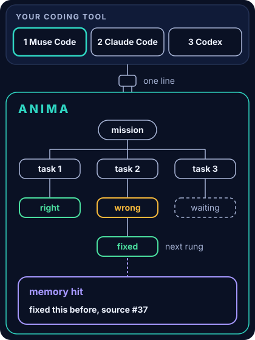
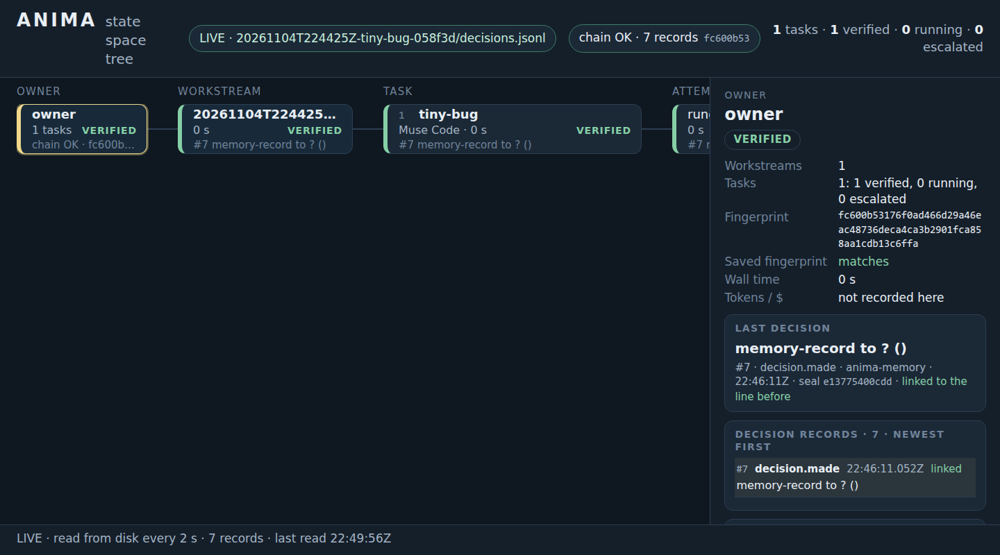

# ANIMA - memory for coding work

**ANIMA is a prototype.** It is a layer you install in one line on top of the coding agent you already use (Muse Code first, then Claude Code, Codex), giving it memory (a prototype link), a checker it cannot see, and a screen to watch it work.

- TRACE memory comes first: every answer carries a record of where it came from.
- Muse Code first; headless adapters for Muse Code, Claude Code and Codex exist.
- Nine recorded bug-fix jobs you can replay, and a state-tree screen to watch them.

**[Replay the nine-job run](https://anshul48.github.io/anima-substrate/demo/)** — the recorded run, checked in your browser.

<p align="center">
  
</p>
<p align="center"><sub>UI preview (illustration of the design, not a screenshot). The real screen is in the <a href="#walkthroughs--visual-proofs">walkthroughs</a>.</sub></p>

[Watch the working films.](https://anshul48.github.io/trace/demos/)
<!-- VIDEO_SLOT: Flagship film - Replace href when rendered -->

## Install

<!-- block:install:start (generated from docs/status.json by tools/site.py sync-readme) -->

```bash
curl -fsSL https://raw.githubusercontent.com/Anshul48/anima-substrate/main/install.sh | sh
anima doctor
```

One line, a private folder, no admin rights. `anima doctor` lists which of Muse Code, Claude Code and Codex it found.

<!-- block:install:end -->

You need Python 3.11 and git. To check the recorded run without installing anything, clone and run the record check:

```bash
git clone https://github.com/Anshul48/anima-substrate
cd anima-substrate
python3 docs/evidence/flagship-run3/check_chain.py --tamper
```

## The 3-minute proof

ANIMA plugs into the coding tool you already use instead of replacing it. Its memory is [TRACE](https://github.com/Anshul48/trace), a memory that sorts a huge pile of text into groups by itself, joined by a prototype link with one small recorded test so far. [Try the memory and the harness.](https://anshul48.github.io/anima-substrate/try.html)

What the recorded runs show, for one job type (fix a bug against hidden tests): nine real bug-fixing jobs from well-known open-source Python libraries, written down decision by decision. Seven were right the first time; two wrong "done" answers were caught by the hidden checker and fixed by the next helper. Across two recorded runs: 18 jobs, 16 verified first try, 2 caught. [Read the run.](https://anshul48.github.io/anima-substrate/evidence.html) Nine jobs in one run is a worked example, not a statistic.

Muse Code was also our main headless worker tool while we built this project: 670 recorded jobs on two machines, 619 finished, about 170 hours of summed worker time, from 1 to 4 November 2026. These are counts from our own job records. We make no claim about cost or speed differences between Muse Code, Claude Code and Codex.

### The ecosystem

One builder, three projects. TRACE is at the front: the memory the other two are built to use. The owner's profile is calibrated as a map of these projects: [github.com/Anshul48](https://github.com/Anshul48).

| Project | Repository | Demo |
|---|---|---|
| TRACE | [Repository](https://github.com/Anshul48/trace) | [Explorer](https://anshul48.github.io/trace/explorer/) |
| ANIMA | [Repository](https://github.com/Anshul48/anima-substrate) | [Recorded demo](https://anshul48.github.io/anima-substrate/demo/) |
| Reflex | [Demo repository](https://github.com/Anshul48/demo-trace-anima-reflex) | [Replay](https://anshul48.github.io/demo-trace-anima-reflex/) |

Reflex is a line of work where an AI looks at a screen and finds the right button to press. It is part of the ecosystem; it does not use TRACE.

### Walkthroughs & Visual Proofs

| Walkthrough | What it is | Open it |
|---|---|---|
| Flagship film (3 min) | One story for TRACE, ANIMA and Reflex | [Watch the working films](https://anshul48.github.io/trace/demos/) |
| State-tree replay | The recorded runs as a tree, in your browser (UI preview) | [UI preview: state tree](docs/ui-preview/index.html) |
| Dashboard preview | Install, status and memory at a glance (UI preview) | [UI preview: dashboard](docs/ui-preview/dashboard.html) |
| Nine-job record check | What the hidden checker decided, plus the sealed record | [Replay the nine-job run](https://anshul48.github.io/anima-substrate/demo/) |

<!-- VIDEO_SLOT: Flagship film - Replace href when rendered -->
<!-- VIDEO_SLOT: ANIMA state-tree replay - Replace href when rendered -->
<!-- VIDEO_SLOT: ANIMA dashboard preview - Replace href when rendered -->
<!-- VIDEO_SLOT: ANIMA nine-job record check - Replace href when rendered -->

## The deep end

- [Receipts](docs/evidence/flagship-run3/README.md): the recorded nine-job run — log, 69-record decision chain, checker output ([earlier run](docs/evidence/flagship-run2/README.md), [TRACE link test](docs/evidence/trace-card-100m/README.md))
- [Reproduce](docs/INTEGRATED-DEMO.md): the one checkable end-to-end run, exact steps ([all generations](docs/REPRODUCE-ALL.md))
- [Architecture](docs/ARCHITECTURE.md): the package, its contracts and the earlier engine ([technical report](docs/TECHNICAL-REPORT.md), [earlier front page](docs/README-technical.md))
- [Research notes](docs/INDEX.md): every document in `docs/`, by topic
- [Status](docs/status.json): the one file every claim comes from ([status page](https://anshul48.github.io/anima-substrate/status.html))
- [Contribute](.github/CONTRIBUTING.md) ([security](.github/SECURITY.md), [changelog](docs/CHANGELOG.md), [citation](docs/CITATION.cff))

Every claim in this README comes from one file, [`docs/status.json`](docs/status.json). A part may say **Working today** only if it lists a command anyone can run and a file that backs it. A check in CI fails if the tables below disagree with it. Marks on the site are never colour alone: filled dot = working today, half dot = prototype, dashed dot = planned.

<details>
<summary>Status of every part</summary>

<!-- block:status:start (generated from docs/status.json by tools/site.py sync-readme) -->

| Part | State | What exists today |
|---|---|---|
| [Memory (TRACE)](https://anshul48.github.io/anima-substrate/memory.html) | **Working today** | Setup, record and recall run: `anima memory setup` prepares a local TRACE store; each `anima run --memory trace` records the run; `anima memory recall` returns similar past fixes, showing only hits re-checked against their source (one recorded fresh-clone run: 1 hit, similarity 0.67, source check OK). A separate small held-out check found 0 hits at 0.30 with the baseline passages; two tuned variants cleared 0.30 on 2 of 3 new tasks (preliminary). |
| [Your harness](https://anshul48.github.io/anima-substrate/harnesses.html) | **Working today** | The Muse Code adapter runs one small bug task end to end: the worker fixes, the hidden checker judges, the record seals. Fresh-clone runs ended VERDICT PASS. |
| [One-line install](https://anshul48.github.io/anima-substrate/install.html) | **Working today** | One line installs ANIMA into a private folder: the code, a small Python environment, a launcher, and a starter `anima.yaml` listing the coding tools it found. No admin rights, no passwords or keys asked. |
| [One screen (SST)](https://anshul48.github.io/anima-substrate/state-tree.html) | **Working today** | `anima status --tree` prints the tree as text and `anima ui` serves the same tree as a page; both read the decision log, and `--demo` draws the built-in record with no run needed. |
| [Voice](https://anshul48.github.io/anima-substrate/voice.html) | **Working today** | `anima voice` turns a clip into text on your own computer (local faster-whisper on the CPU, about 1 to 2 seconds a clip in the fresh-clone runs), matches one of six fixed commands, and asks before running anything. |
| [Roles and rules](https://anshul48.github.io/anima-substrate/rules.html) | **Planned** | A design only, written down in docs/ROLES-AND-RULES.md with what exists marked. No program reads the file or enforces the rules today. The checker, the ladder and the record, which do exist in some form, are on the checker page. |

Roles and rules, part by part: Roles: Planned, Enforced rules: Planned.

Rendered from [`docs/status.json`](docs/status.json); `python3 tools/site.py check` fails if this table or the site disagrees with it.

<!-- block:status:end -->

</details>

<details>
<summary>The harness ladder: Muse Code first</summary>

A harness is the coding tool an agent runs in. ANIMA does not replace it; it plugs in. Muse Code first, then Claude Code, then Codex.

<!-- block:harness:start (generated from docs/status.json by tools/site.py sync-readme) -->

| # | Harness | State | Command |
|---|---|---|---|
| 1 | Muse Code | **Working today** | `anima run --harness muse --task tiny-bug` |
| 2 | Claude Code | **Prototype** | planned: `anima run --harness claude --task tiny-bug` |
| 3 | Codex | **Prototype** | planned: `anima run --harness codex --task tiny-bug` |

<!-- block:harness:end -->

</details>

<details>
<summary>Memory (TRACE) in full</summary>

<!-- block:memory-state:start (generated from docs/status.json by tools/site.py sync-readme) -->

**Working today.** Setup, record and recall run: `anima memory setup` prepares a local TRACE store; each `anima run --memory trace` records the run; `anima memory recall` returns similar past fixes, showing only hits re-checked against their source (one recorded fresh-clone run: 1 hit, similarity 0.67, source check OK). A separate small held-out check found 0 hits at 0.30 with the baseline passages; two tuned variants cleared 0.30 on 2 of 3 new tasks (preliminary).

Limit: A small local store, not the 100-million-token library. Recall is only as good as the runs recorded. Recall of a new, different job is a small preliminary test (baseline 0 hits at 0.30 on 3 held-out tasks). Setup needs the network once.

<!-- block:memory-state:end -->

In a coding workflow the same bug gets fixed twice and the same decision gets explained again. ANIMA's memory is **TRACE**, our public search that shows its work: every answer comes with a record of where it came from. Everything in this section is **our own measurement**; no outside party has verified it. It is TRACE's record, not an ANIMA result.

**The sealed library we tested on: 812,545 passages, 99,891,846 tokens.** The planned 100-million-token gate was waived: the library falls short by 108,154 tokens (0.11%).

- **Sparse activation.** A question wakes only the few groups likely to hold the answer. On 50 test searches (40 written questions and 10 taken from passage openings) TRACE scored **0.79% of the rows**, measured on one of the library's four equal parts. That is about **127 times less scoring work** than looking at everything, and it kept **0.9985 of exact meaning-based search's results**.
- **Self-organizing, as an idea.** TRACE is a self-organizing memory prototype: it sorts passages into groups on its own, with no labels added by people. The sorting is one ordinary automatic step (k-means). The idea is inspired by how brains organize memory; we do not claim TRACE works like a brain. What we measured: at every library size we tested (10,000 to 200,000 passages, one recipe), a passage's ten closest matches fell in about 5 groups on average, where random groups would give 10; for the 50 test searches on our 100-million-token library it was about 7 groups out of 10. This measures how ordered the finished grouping is. It does not show order arising over time, and we do not claim it improves as the library grows. [TRACE's own site](https://anshul48.github.io/trace/) tells this story.
- **A checkable record on every answer.** Each result carries a record of where it came from, with a fingerprint you can recompute yourself.

**Earlier, larger tests (ours, kept apart from the numbers above):**

- **504,480,146 tokens.** Around 28 October 2026 we sealed a TRACE memory of 504,480,146 tokens in 13 parts on a cloud machine. That machine has since been shut down, so this test cannot be re-run. It is an earlier test by us, recorded in our own receipts, and nobody outside has checked it.
- **1.53 billion tokens, routing only.** A separate test on rented GPUs (16 October 2026) turned 1,531,809,092 tokens of a different, larger collection into 7,134,906 searchable vectors in 109 pieces. A search that looked only at the most likely groups kept 0.9947 of the exact top ten while looking at 6.6% of the vectors. It tested routing only: no merged index, not served through TRACE, no checkable records at that scale, and not a one-billion-vector run.

**Where TRACE does not win:** on the same 50 test searches, ordinary keyword search put the right source passage in its top ten for 82% of searches; TRACE did for 52%, and so did exact meaning-based search. Keyword search also had the shorter response time (6 milliseconds against 1.2 seconds for TRACE). Stored size on disk: TRACE 2.28 GB, exact vectors 1.25 GB, keyword index 0.51 GB. TRACE has not been run on public benchmarks, and there is no public query service. Details: [the memory page](https://anshul48.github.io/anima-substrate/memory.html) and the [TRACE repository](https://github.com/Anshul48/trace).

</details>

<details>
<summary>The screen, voice, roles and rules</summary>

<!-- block:sst:start (generated from docs/status.json by tools/site.py sync-readme) -->



*Real screenshot of the state-tree screen showing a recorded run, served from a fresh clone.* [More](https://anshul48.github.io/anima-substrate/state-tree.html). Designed preview: [UI preview: a replay of recorded runs](docs/ui-preview/index.html) ([dashboard](docs/ui-preview/dashboard.html)).

<!-- block:sst:end -->

<!-- block:voice-state:start (generated from docs/status.json by tools/site.py sync-readme) -->

**Working today.** `anima voice` turns a clip into text on your own computer (local faster-whisper on the CPU, about 1 to 2 seconds a clip in the fresh-clone runs), matches one of six fixed commands, and asks before running anything.

Limit: Six fixed English commands. Shown first from a recorded clip. Needs a Python with faster-whisper; the model downloads once.

<!-- block:voice-state:end -->

Architect, manager and worker; secrets, no-push and budgets; a hidden checker; a tamper-evident record. This is the professional discipline behind the other five parts: written down once, and enforced by a program, not by an agent's good intentions. [Design: docs/ROLES-AND-RULES.md](docs/ROLES-AND-RULES.md).

<!-- block:rules-state:start (generated from docs/status.json by tools/site.py sync-readme) -->

**Planned.** A design only, written down in docs/ROLES-AND-RULES.md with what exists marked. No program reads the file or enforces the rules today. The checker, the ladder and the record, which do exist in some form, are on the checker page.

Planned: One file, `anima.yaml`, holds roles, permissions, budgets, watches and the ladder, so it works on any harness.

Limit: Designed from how we actually run our own work. Of the ten controls in the design, ANIMA has two today (the work ladder and the verification gate), and both are on the checker page.

<!-- block:rules-state:end -->

</details>

<details>
<summary>The nine jobs, in full</summary>

We gave the hidden checker and the ladder nine real bug-fixing jobs from well-known open-source Python libraries, and wrote every decision down. The ladder is the order of helpers: a Muse Code worker first (in the recorded runs), then Claude Sonnet, then Codex. Each wrong answer moves up to a stronger helper.

A trimmed copy of the real log ([full file](docs/evidence/flagship-run3/real3.log)):

```text
REAL cachetools-unbound-keyword rung=0 pool=laptop-muse said-done=yes gate=FAIL rule=target-tests
REAL cachetools-unbound-keyword rung=1 pool=claude-sonnet said-done=yes gate=PASS rule=-
REAL click-short-help-abbrev rung=0 pool=laptop-muse said-done=yes gate=FAIL rule=target-tests
REAL click-short-help-abbrev rung=1 pool=claude-sonnet said-done=yes gate=PASS rule=-
```

`rung=0` is the Muse Code worker (`laptop-muse` is its pool name in the log), `rung=1` is Claude Sonnet. `said-done=yes` means the agent claimed it was finished. `gate=FAIL` means the hidden checker disagreed, and `rule=target-tests` means the tests written for that bug failed. In the second case the agent's fix cut a help text in the wrong place, and the next helper was handed the task plus that one failing line ([full checker output](docs/evidence/flagship-run3/rejected-attempt-click-short-help-abbrev.gate.json)).

**Check the written record yourself** (Python 3 and git, about one second):

```bash
python3 docs/evidence/flagship-run3/check_chain.py --tamper
```

```text
recorded run: CHAIN OK - 69 records, every link matches
  file fingerprint (SHA-256): acd95bf03497057c50fc050633eadeb024d1dc49dee55a236cb29f95b989bd5d
  matches the fingerprint saved at the end of the run: yes

changed one character on line 6 of a temporary copy (the original is untouched)
edited copy: CHAIN BROKEN - 69 records, line 7 does not match the line before it
  file fingerprint (SHA-256): 2773ad2824efdce0e88ebbb733641de8bf2b06932c8239f1a23bd0317ea80612
```

Each decision is one line in a file, and each line carries a fingerprint of the line before it, so an edit shows. The same check runs in your browser on the [demo page](https://anshul48.github.io/anima-substrate/demo/). This checks the record. It does not re-run the nine jobs, and it cannot show that the run itself was honest.

</details>

<details>
<summary>Limits, stated once</summary>

- What was validated is **one kind of job**: fix a bug, judged by hidden tests. It is not a general job scheduler. Every other part carries the badge in the table above.
- Nine jobs in one run is a worked example, not a statistic.
- The second helper was told the failing line, so it was an informed retry, not a blind one.
- The libraries are public, so the agents may have seen similar fixes before.
- We make no claim about long runs, or about leaving it alone while you are away. That is untested.
- The checker's code ships in this repository (see the [integrated demo](docs/INTEGRATED-DEMO.md)); the nine-job run used our earlier driver, so only the record of that run can be re-checked from here. The earlier self-test is described in the [run-2 notes](docs/evidence/flagship-run2/README.md).
- The TRACE numbers above are our own measurements on our own library. There is no public query service.

</details>

Rebuild the site from its sources: `python3 tools/site.py build && python3 tools/site.py check`

Apache License 2.0, see [LICENSE](LICENSE).
