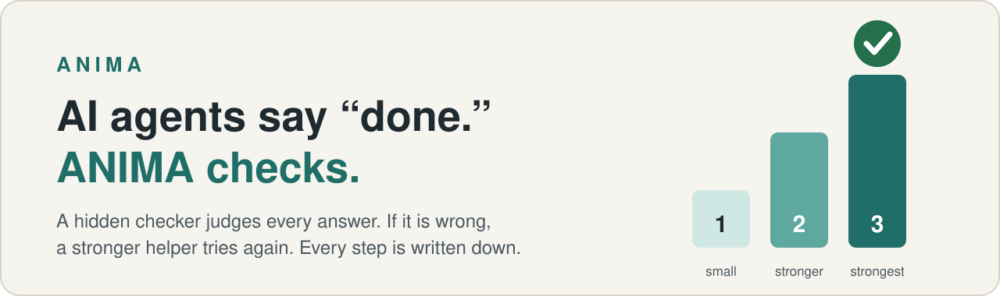
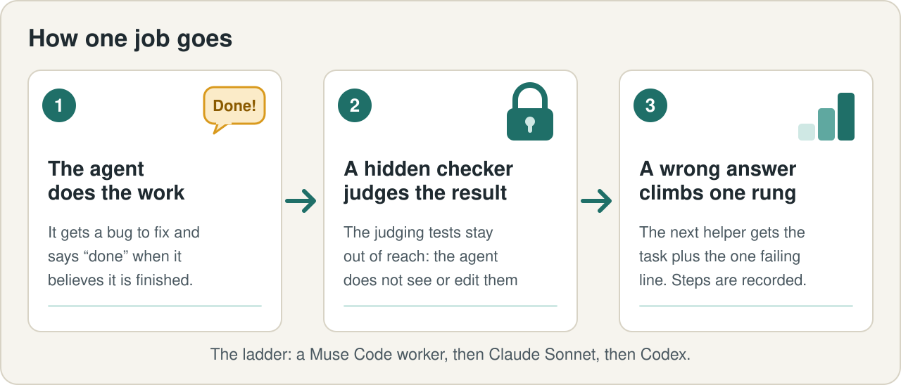
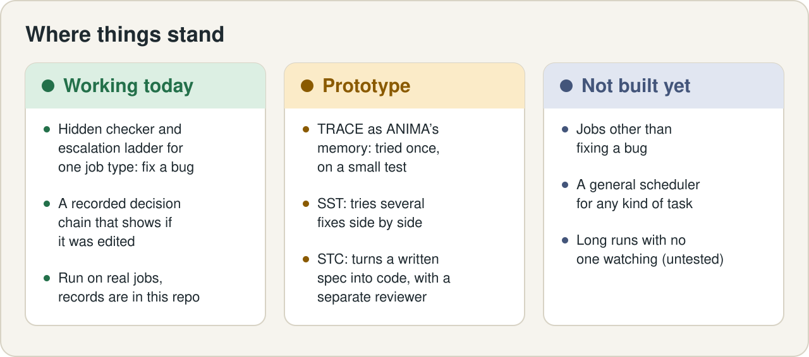

<p align="center">
  
</p>

# ANIMA

**ANIMA's Harness is a safety net for AI coding agents: a hidden checker judges each answer, stronger helpers step in when it is wrong, and every decision goes into a record you can check.**

Its memory is [TRACE](https://github.com/Anshul48/trace), our search that shows its work (the link between the two is a prototype).

## The problem

AI agents are quick to say "done." Sometimes they are right. Sometimes the fix does not hold up, and you find out later.
If the agent's own word is all you have, it is grading its own homework.

ANIMA does not take the agent's word for it.

## Watch it work



The ladder is the order of helpers: a small local model first, then Claude Sonnet, then Codex. Each wrong answer moves up to a stronger helper.

We gave the Harness nine real bug-fixing jobs from well-known open-source Python libraries.

- **Nine jobs.** Each one is a real bug with a plain-English description. The agent has to fix it.
- **Seven were right the first time.** A small model on the laptop did the work, and the hidden tests agreed.
- **Two were wrong.** The agent said "done" both times. The checker said no, the next helper (Claude Sonnet) fixed both, and all nine ended verified.

This is a trimmed copy of the real log ([full file](docs/evidence/flagship-run3/real3.log)):

```text
REAL cachetools-unbound-keyword rung=0 pool=laptop-muse said-done=yes gate=FAIL rule=target-tests
REAL cachetools-unbound-keyword rung=1 pool=claude-sonnet said-done=yes gate=PASS rule=-
REAL click-short-help-abbrev rung=0 pool=laptop-muse said-done=yes gate=FAIL rule=target-tests
REAL click-short-help-abbrev rung=1 pool=claude-sonnet said-done=yes gate=PASS rule=-
```

How to read it: `rung=0` is the small local model, `rung=1` is Claude Sonnet.
`said-done=yes` means the agent claimed it was finished. `gate=FAIL` means the hidden checker disagreed, and `rule=target-tests` means the tests written for that bug failed.

Here is what the checker saw in the second case. The agent's fix cut a help text in the wrong place:

```text
E   AssertionError: assert 'Pick a fruit. 3...' == 'Pick a fruit.'
```

The agent had not noticed. The checker did, and the next helper was handed the task plus that one line.
([Full checker output](docs/evidence/flagship-run3/rejected-attempt-click-short-help-abbrev.gate.json))

## How you use it

**What you can run today: check the written record of those nine jobs.**
You need Python 3 and git. Nothing to install. The download is about 11 MB and the check takes about a second.

```bash
git clone https://github.com/Anshul48/anima-substrate
cd anima-substrate
python3 docs/evidence/flagship-run3/check_chain.py --tamper
```

What it printed when we ran it:

```text
recorded run: CHAIN OK - 69 records, every link matches
  file fingerprint (SHA-256): acd95bf03497057c50fc050633eadeb024d1dc49dee55a236cb29f95b989bd5d
  matches the fingerprint saved at the end of the run: yes

changed one character on line 6 of a temporary copy (the original is untouched)
edited copy: CHAIN BROKEN - 69 records, line 7 does not match the line before it
  file fingerprint (SHA-256): 2773ad2824efdce0e88ebbb733641de8bf2b06932c8239f1a23bd0317ea80612
```

Each decision in the run is one line in a file, and each line carries a digital fingerprint (a tamper-evident seal) of the line before it.
Change anything and the break shows up, as in the second half above.
Your own copy of the file is left as it was.

This checks the record. It does not re-run the nine jobs. A full re-run needs access to each agent on the ladder,
and the Harness code itself is not in this repository yet (see [Next step](#next-step)).

## The parts around it

- **TRACE (prototype link): the memory.** Search that shows its work: every answer comes with a checkable record of where it came from.
  In one small test (20 questions), a helper asked TRACE questions over our full test library and a hidden checker with 23 rules
  accepted the recorded answers. It is a small sample, so we make no wider claim. ([Recorded test](docs/evidence/trace-card-100m/README.md))
- **SST (prototype): tries several fixes side by side** and keeps one only if its checks pass. Not used in the nine jobs above.
- **STC (prototype): turns a written spec into code** in separate working copies, with a separate reviewer before a person merges.
  Not used in the nine jobs above.
- **State space tree screen and voice commands (prototype):** one screen replays the nine-job record as a tree of agents (`python3 -m anima.ui --demo`); a spoken command runs only after you confirm it. [How it works and what is not built](docs/UI.md).

SST and STC live in their own projects, not in this repository.

## Honest limits



*The ladder: each wrong answer moves up to a stronger helper.*

- The Harness is a validated prototype for **one kind of job**: fix a bug, judged by hidden tests.
  It is not a general job scheduler.
- Nine jobs, one run. That is a worked example, not a statistic.
- The second helper was told the failing line, so it was an informed retry, not a blind one.
- The libraries are public, so the agents may have seen similar fixes before.
- We make no claim about long runs, or about leaving it alone while you are away. That is untested.
- Self-test (the checker's own check, plus a run with a deliberately planted fault): described in the
  [run-2 notes](docs/evidence/flagship-run2/README.md). It is not re-runnable from this repository yet.

## Next step

Publish the Harness code and its self-test in this repository, so anyone with access to one of the helper models can re-run the checker end to end.

## For researchers

- [Recorded run: nine jobs](docs/evidence/flagship-run3/README.md), with its [caveats](docs/evidence/flagship-run3/README.md#caveats-state-them-wherever-the-number-is-used)
  and the [earlier run](docs/evidence/flagship-run2/README.md)
- [Previous front page](docs/README-technical.md): the repository's earlier technical page
  (a small offline engine in `src/`; run it: `PYTHONPATH=src python3 examples/quickstart.py`)
- [Technical report](docs/TECHNICAL-REPORT.md) / [Architecture](docs/ARCHITECTURE.md) / [Roadmap](docs/ROADMAP.md) / [Reproduce all](REPRODUCE-ALL.md)
- [Contributing](CONTRIBUTING.md) / [Changelog](CHANGELOG.md) / [Citation](CITATION.cff)

Apache License 2.0, see [LICENSE](LICENSE).
